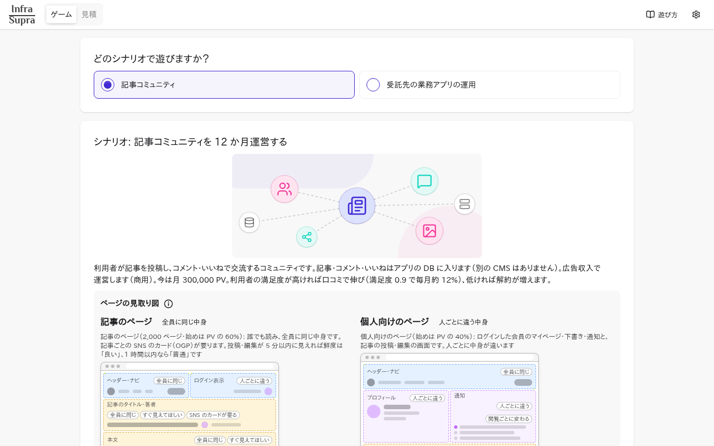
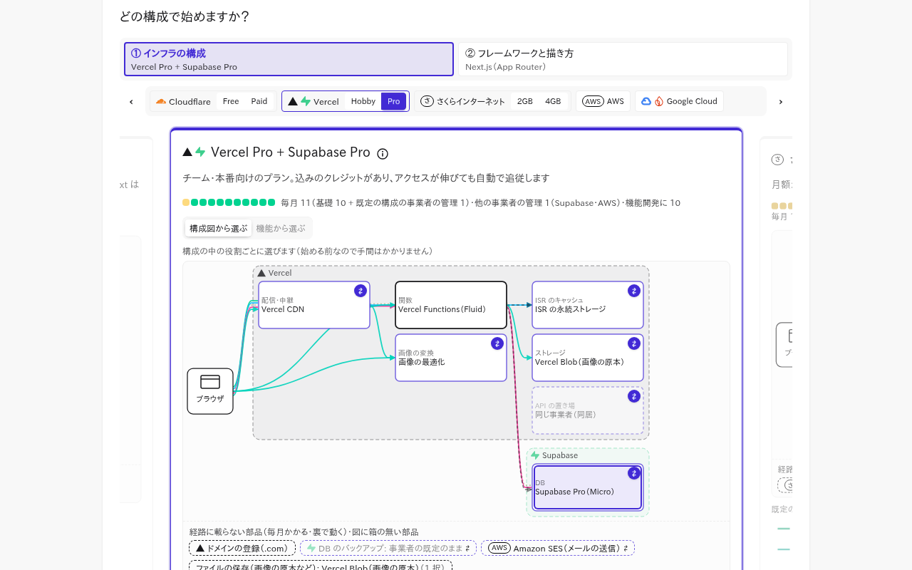
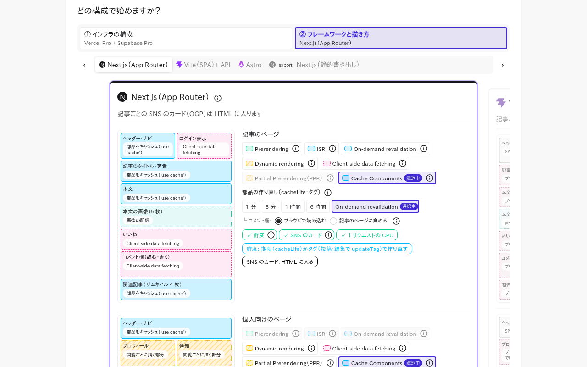
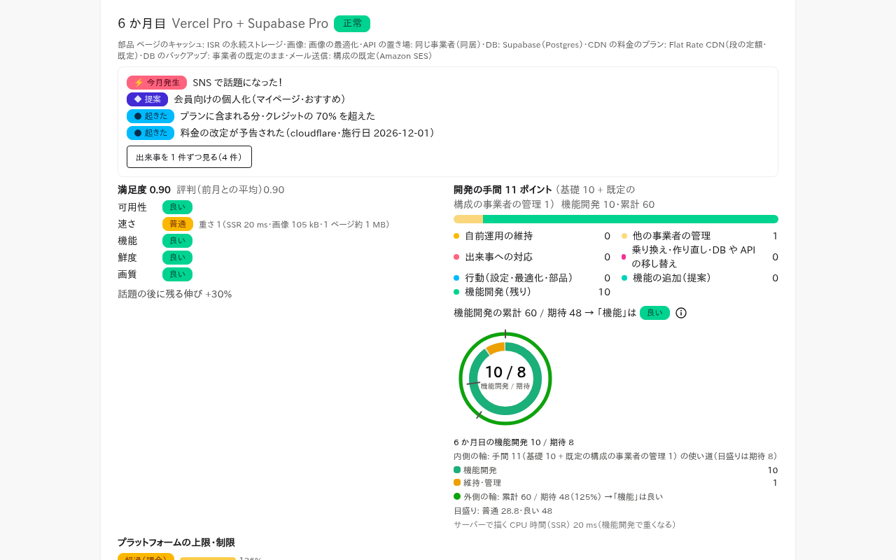
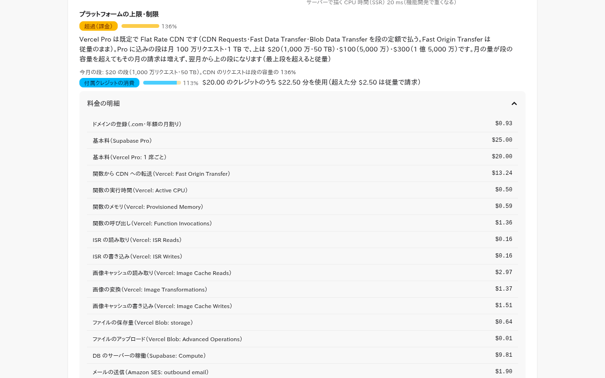
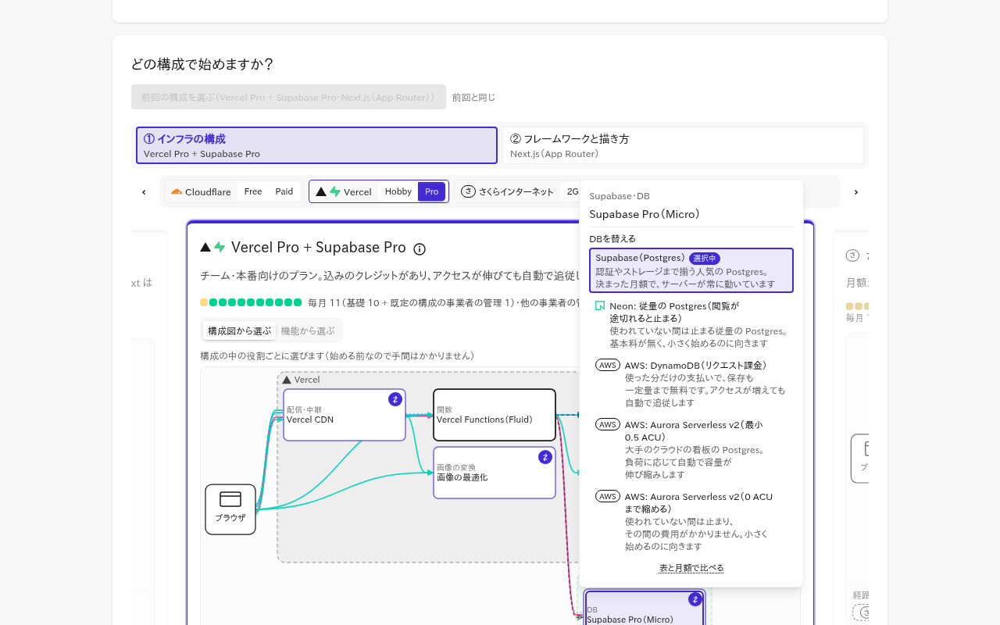
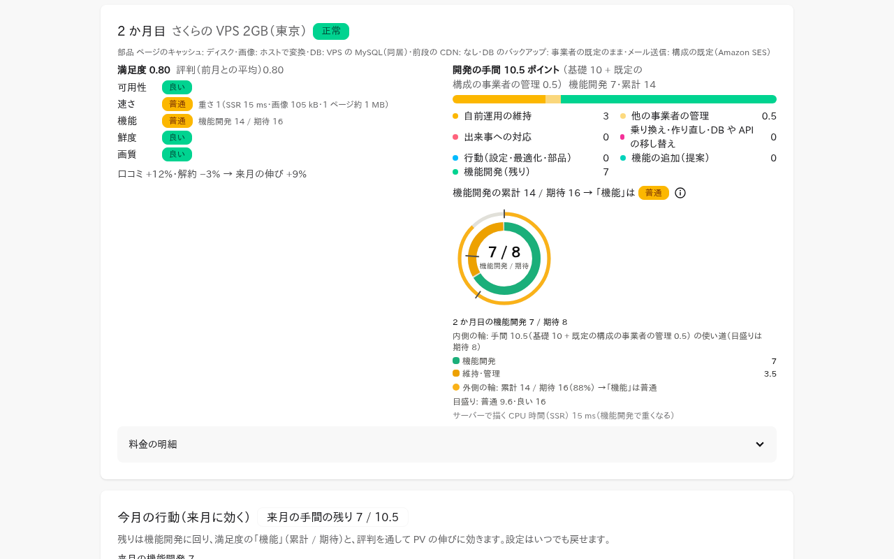
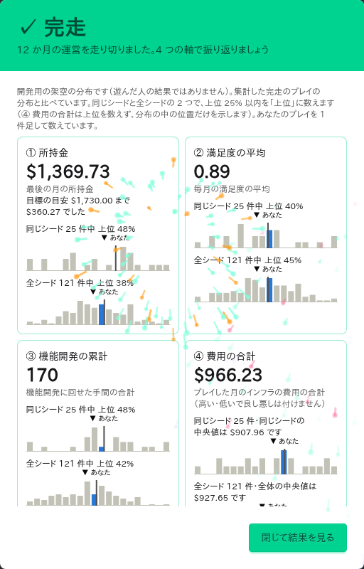

## はじめに
開発初期の Web アプリケーションについて「インフラのコストを見積もってもらえないか」と言われた時、どんな要素に着目するでしょうか？

実装しながら処理の効率やコストを意識していると、ちょっとした機能がコストやインフラと繋がっているような感覚を覚える......のですが、ふわふわした感覚で自信がないなーという事も多いです。

そこでこんな Web サイトを作ってみました。お題・インフラ・フレームワークと使い方を選んで、12 ヶ月の運営をゲーム風に行います。
@[card](https://infra-supra.vercel.app/?ref=zenn)
> サイトの名称は、最近の楽曲や海外の展覧会などと重複している様です......
> もっと良い名前を思い付いたら変更するかもしれません！

:::message alert
カンペキに出来ている訳ではないので、特に以下の点にご留意下さい：
- 料金表は各インフラのデータを取ってきていますが、**最新に追従しているとは限りません**
- **実際の通信量・使用量とは異なります**ため、あくまで目安や傾向を見るものです
- 開発体験の相性が有りますので、**単純に安ければ良い訳ではない**ことにもご注意下さい
:::

## スクリーンショット

*シナリオを選んで、成長するサービスを 12 ヶ月運営します*

*① インフラの構成。構成図の箱を押すと部品を替えられます*

*② フレームワークとページの描き方。ページの部品ごとにキャッシュや作り直しの方法を選びます*

*ゲーム中。出来事・満足度・開発の手間の使い道を見ながら月を進めます*

*上限の使用率と料金の明細。費用が項目ごとに分かります*

## 開発しつつ・遊んでみて気付いたこと
### 1：機能とインフラは特に Next.js で切り離せない場合が多い
フレームワーク・機能とインフラは独立していて欲しいですが、Next.js においては特に切り離せない要素があります。

Cache Components や On-demand ISR といったキャッシュの絡む比較的新しい機能は、Vercel 以外ではフルスペックで動作しないことが多いです。

ざっくり表にすると、2026 年 11 月時点ではこんな感じでした：

| プラットフォーム | Cache Components | On-demand ISR |
|---|---|---|
| Vercel | ○ | ○ |
| VPS などで `next start` | ○ | ○（※1） |
| Google Cloud Run | ○ | ○（※1） |
| AWS Amplify Hosting | ×（Next.js 15 まで対応） | × |
| Cloudflare + vinext | △（一部のみ） | △（キャッシュの置き場所次第） |

:::details ※ どれも動きの速い分野なので、実際に選ぶときは公式情報を確認して下さい......！
- ※1：前段の CDN で HTML までキャッシュすると、再検証が CDN まで届かなくなります。複数インスタンスでキャッシュを揃えるには `cacheHandler` の用意も必要です
- Amplify Hosting は Next.js 15 までが対象で、On-demand ISR は非対応と明記されています（[公式ドキュメント](https://docs.aws.amazon.com/amplify/latest/userguide/ssr-amplify-support.html)）
- vinext は README で `cacheComponents` の挙動がまだ不完全と書かれています。On-demand ISR はキャッシュを R2 や Workers Cache に置けば消せますが、KV に置いた場合は、KV の仕様上、他の地域に変更が見えるまで 60 秒以上かかることがあります（[vinext](https://github.com/cloudflare/vinext)・[Cloudflare KV の仕組み](https://developers.cloudflare.com/kv/concepts/how-kv-works/)）
:::

### 2：DB って難しい
DB をどうするかはどの構成でも悩むことになりました。永続データを管理するコストは安くありません。

一見するとお得そうに感じる Serverless 系の選択肢でも、保存データが膨大だったりインスタンスが休む暇が無かったりすると高く付いてしまいます。「どう使われるか」がインフラも縛る性質が、ここでも強く出ていると感じます。

ゲームでは、構成図の DB の箱から、他の事業者の DB と組み合わせて選び直せるようにしています。Vercel と Supabase の組み合わせ以外にも、Neon や AWS の DynamoDB・Aurora などを試せます。

*構成図の DB の箱を押すと、事業者をまたいだ候補から DB を選べます*

### 3：セルフホストはお得？
インフラを DB も含めて Linux サーバー上に自前で構築して管理できるなら、経済的なサーバーを借りて自前でセットアップするのが安そうですが......

その管理の工数は無視できないですし、止まらないようにインフラを更新し続けるのは至難の業だと思います。

ゲーム中では開発に使える工数が減る形でこの効果を取り入れています。

*自前運用の維持に手間がかかり、機能開発に回せる分が減ります（2 ヶ月目・機能開発 7 / 期待 8）*

## まとめ
AI が出てくる以前から、インフラの選択や構成は悩み甲斐のあるテーマでした。

今も情報収集という形で強力に手伝ってくれるようになったとはいえ、AI が責任を取ってインフラ確保までしてくれるのは、きっともう少しだけ先です。

インフラを意識しながらのフロントエンド開発は、まだ人間が考える余地のあるテーマである様に思います。

今後も開発を進めて、触っていて楽しいサイトにしていきたいです！
どうしても情報過多気味になるため、うまく工夫してスッキリする様に改良していきます。

## おまけ
infra-supra にはプレイ結果の統計データを取得する機能があります。

皆さんが自然だと思うインフラ・フレームワーク構成を選んでみて、他の方と比べてどうだったかをぜひ見てみて頂きたいです！

*12 ヶ月を終えた結果。4 つの軸で他のプレイと見比べます*

